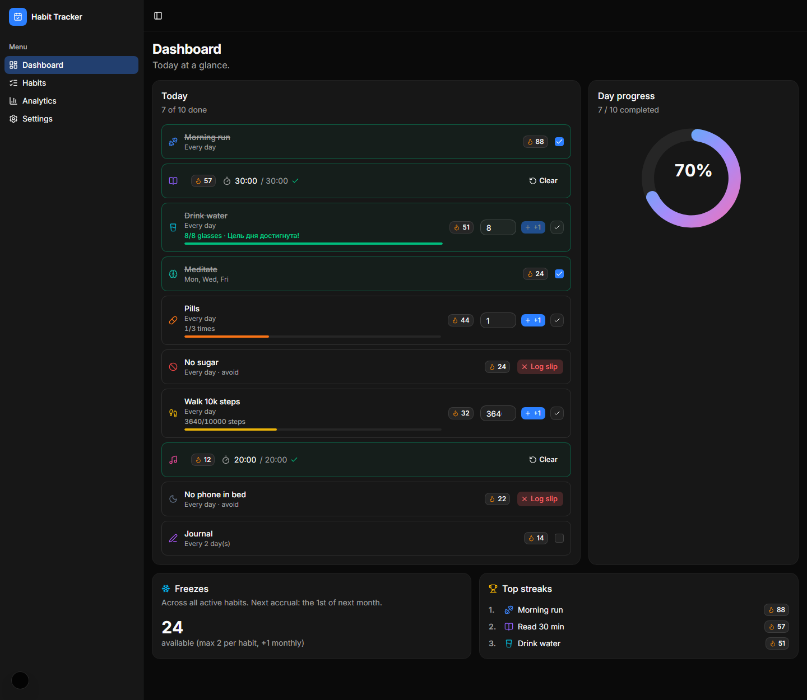
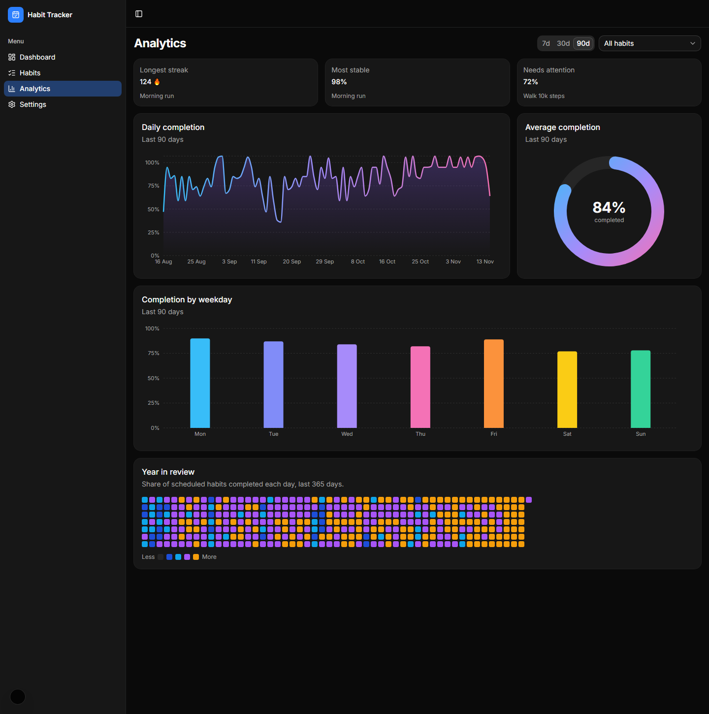
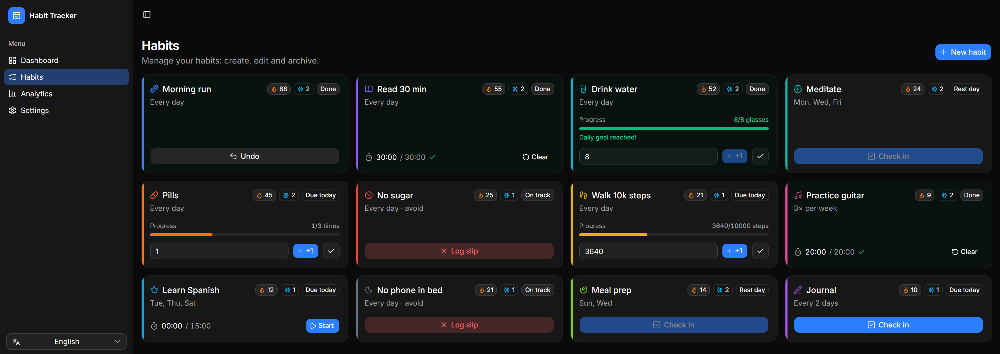
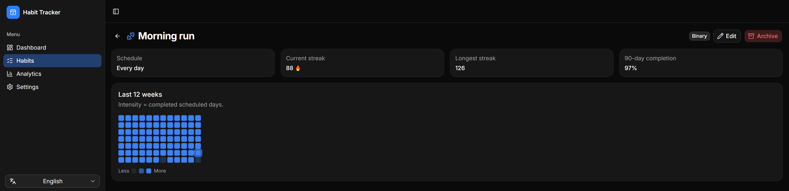
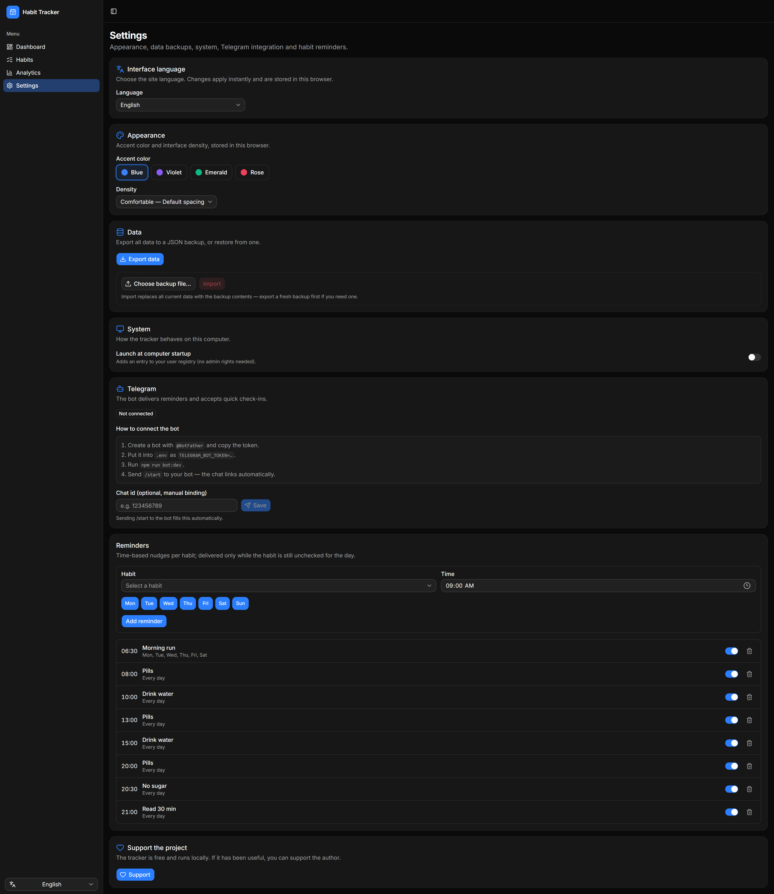
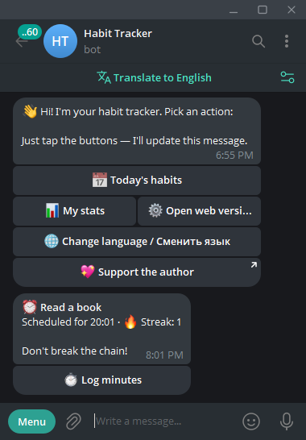

https://github.com/user-attachments/assets/9931ff4d-c968-4e7f-b29e-a06a67911113

[🇬🇧 English](README.md) | [🇷🇺 Русский](README.ru.md)

# Habit Tracker

A local-first habit tracker with flexible schedules, soft streaks and an optional
Telegram bot. Everything runs on your machine: SQLite storage, no accounts, no cloud.

[](https://github.com/h4rr0u/Simple-Habit-Tracker/actions/workflows/ci.yml)
[](https://github.com/h4rr0u/Simple-Habit-Tracker/releases)
[](LICENSE)


[](https://www.donationalerts.com/r/h4rr0u)

**Current version: v1.1.0**

## Contents

- [Screenshots](#screenshots)
- [Features](#features)
- [Tech stack](#tech-stack)
- [Installation for beginners](#installation-for-beginners)
- [Telegram bot (optional)](#telegram-bot-optional)
- [Backups](#backups)
- [Updating](#updating)
- [Settings](#settings)
- [For developers](#for-developers)
- [Habit types](#habit-types)
- [Streaks & freezes](#streaks--freezes)
- [Scripts](#scripts)
- [Project structure](#project-structure)
- [Contributing](#contributing)
- [License](#license)

## Screenshots

Taken from the bundled demo dataset (`npm run db:seed:demo`), so they match what
the app actually shows. The Telegram bot is shown in its own section below.

| Dashboard                                          | Analytics                                    |
| -------------------------------------------------- | -------------------------------------------- |
|        |  |

| Habits                                    | Habit detail                                       |
| ----------------------------------------- | -------------------------------------------------- |
|     |  |



## Features

- **Four habit types** — binary, quantitative, negative and timed, each with its
  own target, unit and color.
- **Flexible schedules** — every day, N times per week, specific weekdays, or
  every N days.
- **Soft streaks with freezes** — a missed day can spend a "freeze" instead of
  resetting the streak; every habit earns one freeze per month (max 2).
- **Analytics** — completion chart, weekday bars, a year heatmap, weekday and
  time-of-day patterns, habit correlations, long-term trends over 12/36/60
  months, plus CSV and print/PDF export.
- **Telegram bot (optional)** — reminders, inline check-ins, language switch and
  menu buttons.
- **Habit templates** — 10 ready-made habits for health, mindfulness, learning
  and productivity.
- **Categories and tags** — organize habits and filter the grid by category.
- **Free-form grid** — a 4-column drag-and-drop canvas; cards snap to cells and
  empty cells are preserved.
- **Smooth motion** — framer-motion transitions for cards, dialogs, progress and
  charts, with reduced-motion support.
- **Appearance** — light/dark/system theme, five accent palettes (blue, violet,
  emerald, orange, rose) and compact/comfortable density.
- **Windows launchers** — `start.bat`, `update.bat` and optional launch at login.
- **JSON backups** — one-click export/import of all data for backups and migration.
- **English and Russian UI** — switch the language in Settings at any time.
- **DonationAlerts link** — an optional support card and bot button.

## Tech stack

Next.js 15 (App Router) · TypeScript · Tailwind CSS 4 + shadcn/ui · SQLite
(better-sqlite3, WAL) + Drizzle ORM · Recharts · framer-motion · @dnd-kit/core ·
next-themes · grammY + node-cron.

## Installation for beginners

You do **not** need to be a programmer or use a terminal. The first launch takes
2–3 minutes because the app downloads and configures everything automatically.

### Step 1. Install Node.js

Node.js is the free runtime the tracker needs.

1. Open <https://nodejs.org/en>.
2. Click the big **LTS** button — this is the stable version (22 or newer). The
   **Current** version also works, but LTS is safer.
3. Run the downloaded installer and keep clicking **Next** until it finishes.
   You do not need to change any checkboxes.

### Step 2. Download the project

1. On the project page on GitHub, click the green **Code** button → **Download ZIP**.
2. Extract the archive into a convenient folder.
   Important: extract it first — do not run the tracker directly from the ZIP file.

### Step 3. Start the tracker

Double-click **`start.bat`** in the project folder.

- On the first launch you will see "Installing dependencies, this may take a
  couple of minutes..." — wait 2–3 minutes and do not close the window.
- The launcher then creates the database and starts the tracker.
- When you see `[web]` lines in the window, open **<http://localhost:3000>** in
  your browser.

The black console window is the tracker's engine. While it is open, the tracker
is running; closing the window (or pressing `Ctrl+C`) stops it. Next time just
double-click `start.bat` again — startup will be much faster.

If something goes wrong, the window stays open and shows the error text so you
can read or copy it before closing.

Telegram reminders are optional and configured separately — see
[Telegram bot (optional)](#telegram-bot-optional).

### What `start.bat` does

1. Checks that Node.js is installed and tells you where to download it if not.
2. Runs `npm install` if the `node_modules` folder is missing.
3. Runs `npm run db:migrate` — safe on every launch, so the database schema is
   always up to date.
4. Runs `npm run start:all` — the production web app (builds it first when
   `.next` is missing), plus the bot and reminders when a Telegram token is
   configured.
5. Keeps the window open (`pause`) on failure so you can read the error.

### Troubleshooting

- **"Node.js not found"** — install Node.js (Step 1) and run `start.bat` again.
- **The window flashed and closed** — run `start.bat` again. On errors it now
  stays open and shows the message; copy it into a GitHub issue.
- **Port 3000 is busy** — close another tracker window or the program using that
  port, then start again.
- **No Telegram reminders** — make sure the file is named exactly `.env` (not
  `.env.txt`) and that `TELEGRAM_BOT_TOKEN` is filled in.

### Where the data lives

Everything is stored locally in `data\habit-tracker.db` — no accounts and no
cloud. To make a backup, open **Settings → Data** and export a JSON file.

## Telegram bot (optional)

The web app works without Telegram — the bot only adds reminders and quick
check-ins from your phone. It reads the same `.env` file and writes to the same
SQLite database.

<p align="center">
  
</p>

1. Open [@BotFather](https://t.me/BotFather) in Telegram and send `/newbot`.
2. Choose a display name, then a username ending in `bot` (e.g. `my_habits_bot`).
3. Copy the token BotFather gives you.
4. Put it into `.env` (copy `.env.example` to `.env` first):

   ```
   TELEGRAM_BOT_TOKEN=123456:ABC-DEF...
   ```

5. Start everything with the launcher — or run the processes separately:

   ```bash
   npm run start:all      # web + bot + reminders in one terminal
   # or, in separate terminals:
   npm run bot:dev        # long-polling bot
   npm run reminders:dev  # cron that sends due reminders every minute
   ```

6. Send `/start` to your bot — the chat binds automatically and an inline menu
   appears. Commands:
   - `/today` — today's habits with quick check-in buttons;
   - `/cancel` — cancel a value input;
   - `/language` — switch the bot language (English / Russian);
   - `/support` — support the author (only when `DONATION_URL` is set).

To disable the bot, clear `TELEGRAM_BOT_TOKEN` in `.env` and restart — the web
app keeps working on its own.

Telegram does not accept `http://localhost:3000` as an inline-button URL, so the
"Open web version" button first shows the address as a text link. Set
`WEB_APP_URL` to a publicly reachable address (for example an ngrok tunnel) to
turn it into a real link button.

Reminders only fire while the habit is still unchecked for the day, and the
`reminder_log` table guarantees each reminder is sent at most once per day, even
across process restarts.

## Backups

In **Settings → Data** you can export everything (habits, check-ins, reminders,
settings) to a single JSON file and import it back later. Import **replaces** the
current database contents, so keep the exported file safe. This is also the way
to move your data between machines.

## Updating

Before updating, stop the tracker: press `Ctrl+C` in the black console window
(or close it). The updater refuses to run while port 3000 is busy, so the
database is never changed behind a running server.

Then double-click **`update.bat`**. It always saves a copy of the SQLite
database to `backup\` first (`habit-tracker-YYYY-MM-DD.db`), so your habits and
check-ins are protected even if an update goes wrong.

### Git version (cloned repository)

If the project folder contains `.git`, `update.bat` runs
`scripts\update.mjs`, which:

1. backs up the database to `backup\`;
2. runs `git pull` for the current branch;
3. runs `npm install` when `package.json` has changed;
4. applies new Drizzle migrations with `npm run db:migrate`;
5. rebuilds the app with `npm run build` when source files or dependencies
   changed (or when `.next` is missing).

When it finishes, start the tracker again with **`start.bat`**.

If a migration fails, the updater stops, prints the error and **keeps** the
backup. Restore `data\habit-tracker.db` from `backup\` or contact the
developer before trying again.

### ZIP version (downloaded as an archive)

A ZIP copy has no `.git` folder, so automatic updates are not available.
`update.bat` shows the same instructions instead of failing:

1. Download the new ZIP from GitHub.
2. Extract it into a new folder.
3. Copy `.env` and your database (`*.db`, usually `data\habit-tracker.db`) from
   the old folder into the new one.
4. Run `start.bat` in the new folder.

Keep the old folder until you have checked that the new version works. Release
notes and archives: <https://github.com/h4rr0u/Simple-Habit-Tracker/releases>.

## Settings

### Donation link (optional)

Set `DONATION_URL` in `.env` to show a support card at the bottom of Settings and
a **Support** button in the bot's `/support` reply. Leave it empty to hide both.

### Launch at Windows startup

In **Settings → System**, the "Launch at computer startup" switch makes the
tracker start automatically when you log into Windows.

- The switch adds one entry to **your user's** registry
  (`HKEY_CURRENT_USER\Software\Microsoft\Windows\CurrentVersion\Run`, name
  `Habit Tracker`) — no administrator rights and no system-wide changes.
- Turn it off in the same place or via **Task Manager → Startup apps**.
- At boot the tracker starts in the background without a console window (via the
  hidden `start-hidden.vbs` launcher) and is available at
  [http://localhost:3000](http://localhost:3000).

## For developers

Requirements: **Node.js ≥ 22.9** and npm. The Windows launchers (`start.bat`,
`update.bat`) are optional — on macOS and Linux use the npm scripts below.

```bash
git clone https://github.com/h4rr0u/Simple-Habit-Tracker.git
cd Simple-Habit-Tracker
npm install
npm run db:migrate   # create the SQLite database in ./data
npm run dev          # http://localhost:3000 (web only)
# or everything at once (web + bot + reminders in one terminal):
npm run start:all
```

The launcher reads `.env` and decides what to start. The web app runs as a
production build (`next start`); if `.next` is missing, `npm run build` runs
automatically first. Force a rebuild with `npm run start:all -- --build`.

- **Without Telegram** — leave `TELEGRAM_BOT_TOKEN` empty (or don't create a
  `.env` at all). The launcher prints a warning and runs only the web app.
- **With Telegram** — copy `.env.example` to `.env` and fill in
  `TELEGRAM_BOT_TOKEN=...`. The launcher then also starts the bot and the
  reminder cron.

Output is prefixed with colored tags so one terminal stays readable: `[web]`,
`[bot]`, `[cron]`. `Ctrl+C` (or closing the window) stops every process started
by the launcher.

Prefer separate terminals? Use `npm run dev`, `npm run bot:dev` and
`npm run reminders:dev`.

The web app never needs a Telegram token — the bot is fully optional.

See [CONTRIBUTING.md](CONTRIBUTING.md) for the checks to run before a PR
(`npm run test`, `npx tsc --noEmit`, `npm run lint`, `npm run build`).

## Habit types

| Type             | Meaning                                | Check-in                                      |
| ---------------- | -------------------------------------- | --------------------------------------------- |
| **Binary**       | Simple done / not done (e.g. meditate) | Toggle done                                   |
| **Quantitative** | Count towards a target (e.g. 8 glasses)| Enter a number; optional target value + unit  |
| **Negative**     | Something to avoid (e.g. no smoking)   | A check-in marks a slip                       |
| **Timed**        | Time spent towards a goal (e.g. 30 min)| Enter minutes; stored as seconds, optional target |

Each habit gets its own schedule (days of the week and/or times), color and a
freeze bank.

## Streaks & freezes

Streaks are **soft**:

- A streak counts consecutive **scheduled** days with a completion (for
  quantitative/timed habits the recorded value must meet the target).
- A missed scheduled day normally resets the streak — unless the habit has a
  **freeze** available. A freeze covers the gap: the streak is preserved but
  does not grow.
- Every habit accrues **1 freeze per month** (on the 1st, starting the month
  after creation), with a hard cap of **2** in the bank, so freezes never pile
  up. The current balance is shown on the dashboard and habit pages.

## Scripts

| Command                 | What it does                                                          |
| ----------------------- | --------------------------------------------------------------------- |
| `npm run dev`           | Web app (Next.js dev server)                                          |
| `npm run start:all`     | Everything at once: production web build + bot + reminders (Ctrl+C stops all) |
| `npm run build`         | Production build                                                      |
| `npm run start`         | Serve the production build                                            |
| `npm run test`          | Run unit tests (Vitest)                                               |
| `npm run test:watch`    | Run unit tests in watch mode                                          |
| `npm run lint`          | ESLint                                                                |
| `npm run db:generate`   | Generate a new Drizzle migration from the schema                      |
| `npm run db:migrate`    | Apply Drizzle migrations to the SQLite database                       |
| `npm run db:seed:demo`  | Build a realistic demo database at `./data/demo.db`                   |
| `npm run db:studio`     | Open Drizzle Studio                                                   |
| `npm run bot:dev`       | Telegram bot (long polling)                                           |
| `npm run reminders:dev` | Reminder cron (checks due reminders every minute)                     |

## Project structure

```
src/
  app/        # Next.js pages (dashboard, habits, analytics, settings)
  actions/    # Server Actions (Zod-validated mutations)
  components/ # UI components (shadcn/ui based)
  db/         # Drizzle schema + queries
  lib/        # Pure logic: streaks, freezes, schedules, analytics
  types/      # Shared types
  bot/        # Telegram bot (grammY)
scripts/      # Standalone processes (reminder cron, launcher and updater)
drizzle/      # SQL migrations
```

## Contributing

Contributions are welcome. See [CONTRIBUTING.md](CONTRIBUTING.md) — short
version: run `npm run test`, `npx tsc --noEmit`, `npm run lint` and
`npm run build` before opening a pull request.

## License

[MIT](LICENSE)
