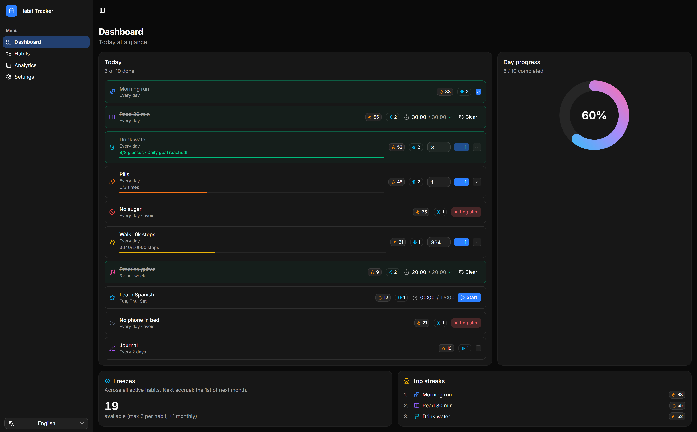
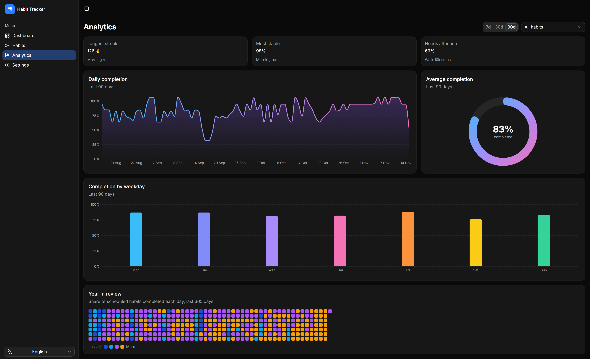
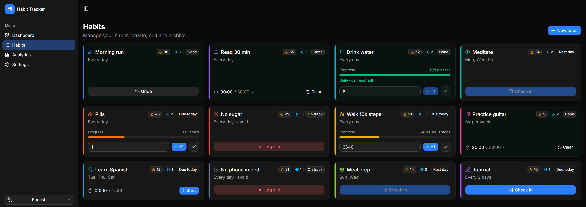
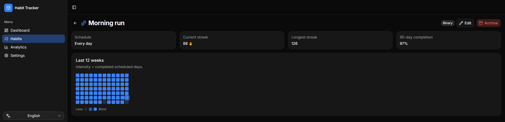
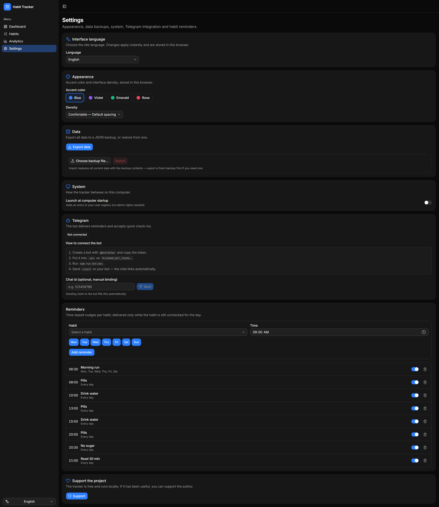

[🇬🇧 English](README.md) | [🇷🇺 Русский](README.ru.md)

# Habit Tracker

Локальный трекер привычек с гибким расписанием, мягкими сериями и опциональным
Telegram-ботом. Всё работает на вашем компьютере: данные хранятся в SQLite,
никаких аккаунтов и облака.

[](https://github.com/h4rr0u/habit-tracker/actions/workflows/ci.yml)
[](https://github.com/h4rr0u/habit-tracker/releases/tag/v1.0.0)
[](LICENSE)


**Текущая версия: v1.0.0** — первый публичный релиз.

## Скриншоты

Сняты на демонстрационных данных (`npm run db:seed:demo`), поэтому совпадают с
тем, что вы увидите в приложении.

| Главная                                       | Аналитика                                     |
| --------------------------------------------- | --------------------------------------------- |
|     |   |

| Привычки                                  | Карточка привычки                                |
| ----------------------------------------- | ------------------------------------------------ |
|   |    |



## Возможности

- **Четыре типа привычек** — бинарные, количественные, негативные и на время.
- **Гибкое расписание** — каждый день, N раз в неделю, конкретные дни недели или раз в N дней.
- **Мягкие серии с заморозками** — пропущенный день можно закрыть «заморозкой», не сбрасывая серию.
- **Аналитика** — график выполнения, столбцы по дням недели и тепловая карта за год.
- **Telegram-бот** — быстрые отметки с телефона и напоминания по расписанию.
- **Настройки внешнего вида** — акцентные цвета, компактный/удобный режим, тёмная тема по умолчанию.
- **JSON-резервные копии** — экспорт и импорт всех данных в один клик.
- **Интерфейс на русском и английском** — язык переключается в настройках в любой момент.

## Технологии

Next.js 15 (App Router) · TypeScript · Tailwind CSS 4 + shadcn/ui · SQLite
(better-sqlite3, WAL) + Drizzle ORM · Recharts · grammY + node-cron.

## Установка для новичков

Программировать и открывать терминал **не нужно**. Первый запуск занимает
2–3 минуты: программа сама скачает и настроит всё необходимое.

### Шаг 1. Установите Node.js

Node.js — бесплатная программа, на которой работает трекер.

1. Откройте сайт <https://nodejs.org/en>.
2. Нажмите большую кнопку **LTS** — это стабильная версия (22 или новее).
   Версия **Current** тоже подойдёт, но LTS надёжнее.
3. Запустите скачанный файл и нажимайте **Next / Далее**, пока установка не
   закончится. Никакие галочки менять не нужно.

### Шаг 2. Скачайте проект

1. На странице проекта на GitHub нажмите зелёную кнопку **Code** → **Download ZIP**.
2. Распакуйте архив в удобную папку.
   Важно: именно распакуйте, а не запускайте трекер прямо из ZIP-архива.

### Шаг 3. (Необязательно) Подключите Telegram-бота

Без этого шага всё работает — просто не будет напоминаний в Telegram.

1. В папке проекта найдите файл `.env.example`.
2. Переименуйте его в `.env` — уберите `.example` в конце имени.
   Если Windows не показывает расширения файлов, включите их в Проводнике:
   **Вид** → **Показать** → **Расширения имён файлов**.
3. Откройте Telegram, найдите [@BotFather](https://t.me/BotFather) и отправьте
   ему `/newbot`.
4. Придумайте имя бота и username, заканчивающийся на `bot`. BotFather пришлёт
   токен — длинную строку вида `123456789:ABC-DEF...`.
5. Откройте созданный файл `.env` (двойным щелчком — откроется Блокнот) и
   вставьте токен в строку `TELEGRAM_BOT_TOKEN=`:

   ```
   TELEGRAM_BOT_TOKEN=123456789:ABC-DEF...
   ```

6. Сохраните файл (**Ctrl+S**) и закройте Блокнот.

Позже отправьте боту `/start`, чтобы привязать чат.

### Шаг 4. Запустите трекер

Дважды щёлкните по файлу **`start.bat`** в папке проекта.

- При первом запуске появится надпись «Устанавливаю зависимости, это займёт пару
  минут...» — подождите 2–3 минуты и не закрывайте окно.
- Затем программа создаст базу данных и запустит трекер.
- Когда в окне появятся строки `[web]`, откройте в браузере
  **<http://localhost:3000>**.

Чёрное окно — это «мотор» трекера. Пока оно открыто, трекер работает; если
закрыть окно (или нажать `Ctrl+C`), он остановится. Для следующего запуска
снова щёлкните `start.bat` — на этот раз всё стартует за пару секунд.

Если что-то пойдёт не так, окно останется открытым и покажет текст ошибки —
прочитайте или скопируйте его перед закрытием.

### Что делает `start.bat`

1. Проверяет, установлен ли Node.js, и подсказывает, где его скачать.
2. Если папки `node_modules` нет — выполняет `npm install`.
3. Всегда выполняет `npm run db:migrate` — команда безопасна при повторном
   запуске, поэтому структура базы всегда актуальна.
4. Запускает `npm run start:all` — production-версию веб-приложения (при
   отсутствии `.next` сначала выполняется сборка), а при наличии токена ещё
   бота и напоминания.
5. При ошибке оставляет окно открытым (`pause`), чтобы вы успели прочитать текст.

### Если что-то не получилось

- **«Не найден Node.js»** — установите Node.js (шаг 1) и запустите `start.bat` снова.
- **Окно мигнуло и закрылось** — запустите `start.bat` ещё раз; при ошибке он
  остаётся открытым и показывает текст. Скопируйте его в issue.
- **Порт 3000 занят** — закройте другое окно с трекером или программу на этом
  порту и запустите снова.
- **Нет напоминаний в Telegram** — проверьте, что файл называется именно `.env`
  (не `.env.txt`) и что в нём заполнен `TELEGRAM_BOT_TOKEN`.

### Где хранятся данные

Всё лежит локально, в файле `data\habit-tracker.db` — никаких аккаунтов и
облака. Чтобы сделать резервную копию, откройте **Настройки → Данные** и
выгрузите JSON-файл.

## Telegram-бот (необязательно)

1. Откройте [@BotFather](https://t.me/BotFather) в Telegram и отправьте `/newbot`.
2. Придумайте отображаемое имя, затем username, заканчивающийся на `bot`
   (например, `my_habits_bot`).
3. Скопируйте токен, который пришлёт BotFather.
4. Вставьте его в `.env` (сначала скопируйте `.env.example` в `.env`):

   ```
   TELEGRAM_BOT_TOKEN=123456:ABC-DEF...
   ```

5. Запустите всё через `start.bat` — или запускайте процессы раздельно:

   ```bash
   npm run start:all      # веб + бот + напоминания в одном терминале
   # или в отдельных терминалах:
   npm run bot:dev        # бот в режиме long polling
   npm run reminders:dev  # проверка напоминаний раз в минуту
   ```

6. Отправьте боту `/start` — чат привяжется автоматически и появится меню с
   кнопками. Команды:
   - `/today` — привычки на сегодня с кнопками быстрой отметки;
   - `/cancel` — отменить ввод значения;
   - `/language` — переключить язык бота (русский / английский);
   - `/support` — поддержать автора (только если задан `DONATION_URL`).

Telegram не принимает `http://localhost:3000` как ссылку inline-кнопки, поэтому
кнопка «Открыть веб-версию» сначала показывает адрес текстовой ссылкой. Укажите
`WEB_APP_URL` с публично доступным адресом (например, туннель ngrok), чтобы
превратить её в настоящую кнопку-ссылку.

Отметки из бота пишутся в ту же базу SQLite, поэтому сразу видны в веб-интерфейсе.

Напоминания приходят, только пока привычка не отмечена за день, а таблица
`reminder_log` гарантирует, что каждое напоминание отправляется не чаще одного
раза в день — даже после перезапуска программы.

## Резервные копии

В **Настройках → Данные** можно выгрузить всё (привычки, отметки, напоминания,
настройки) в один JSON-файл и позже импортировать обратно. Импорт **заменяет**
текущее содержимое базы, поэтому сохраните выгруженный файл. Это же способ
перенести данные на другой компьютер.

## 🔄 Обновление

Перед обновлением остановите трекер: нажмите `Ctrl+C` в чёрном окне консоли
(или закройте его). Скрипт не запустится, пока порт 3000 занят, поэтому база
данных не меняется «на ходу».

Затем дважды щёлкните по файлу **`update.bat`**. Он всегда сначала сохраняет
копию базы SQLite в папку `backup\` (`habit-tracker-ГГГГ-ММ-ДД.db`), поэтому
привычки и отметки защищены, даже если обновление пойдёт не так.

### Git-версия (репозиторий склонирован)

Если в папке проекта есть `.git`, `update.bat` запускает
`scripts\update.mjs`, который:

1. делает резервную копию базы в `backup\`;
2. выполняет `git pull` для текущей ветки (`main` или `master`);
3. запускает `npm install`, если изменился `package.json`;
4. применяет новые миграции Drizzle через `npm run db:migrate`.

После завершения запустите трекер снова через **`start.bat`**.

Если миграция упадёт, скрипт остановится, покажет ошибку и **не удалит**
резервную копию. Восстановите `data\habit-tracker.db` из `backup\` или
свяжитесь с разработчиком, прежде чем пробовать снова.

### ZIP-версия (скачан архив)

В ZIP-копии нет папки `.git`, поэтому автоматическое обновление недоступно.
`update.bat` не падает с ошибкой, а показывает пошаговую инструкцию:

1. Скачайте новый ZIP с GitHub.
2. Распакуйте его в новую папку.
3. Скопируйте файлы `.env` и *.db (базу данных, обычно
   `data\habit-tracker.db`) из старой папки в новую.
4. Запустите `start.bat` в новой папке.

Не удаляйте старую папку, пока не убедитесь, что новая версия работает.
Релизы и архивы: <https://github.com/h4rr0u/habit-tracker/releases>.

## Настройки

### Ссылка на донаты (необязательно)

Укажите `DONATION_URL` в `.env`, чтобы показать карточку поддержки внизу
страницы настроек и кнопку **Поддержать** в ответе бота на `/support`.
Пустое значение скрывает и то, и другое.

### Автозапуск при входе в Windows

В **Настройках → Система** переключатель «Запускать при входе в систему»
включает автоматический запуск трекера при входе в Windows.

- Переключатель добавляет одну запись в реестр **вашего пользователя**
  (`HKEY_CURRENT_USER\Software\Microsoft\Windows\CurrentVersion\Run`, имя
  `Habit Tracker`) — без прав администратора и без изменений в системе.
- Отключить автозапуск можно там же или в **Диспетчере задач → Автозагрузка**.
- При входе трекер запускается в фоне, без окна консоли (через скрытый
  `start-hidden.vbs`), и доступен по адресу
  [http://localhost:3000](http://localhost:3000).

## Для разработчиков

Требования: **Node.js ≥ 22.9** и npm.

```bash
git clone https://github.com/h4rr0u/habit-tracker.git
cd habit-tracker
npm install
npm run db:migrate   # создать базу SQLite в ./data
npm run dev          # http://localhost:3000 (только веб)
# или всё сразу (веб + бот + напоминания в одном терминале):
npm run start:all
```

Лаунчер читает `.env` и решает, что запускать. Веб-приложение работает как
production-сборка (`next start`); если папки `.next` нет, сначала автоматически
выполняется `npm run build`. Принудительная пересборка: `npm run start:all -- --build`.

- **Без Telegram** — оставьте `TELEGRAM_BOT_TOKEN` пустым (или не создавайте
  `.env`). Лаунчер покажет предупреждение и запустит только веб-приложение.
- **С Telegram** — скопируйте `.env.example` в `.env` и заполните
  `TELEGRAM_BOT_TOKEN=...`. Тогда лаунчер также запустит бота и планировщик
  напоминаний.

Строки вывода помечены цветными тегами, чтобы один терминал оставался читаемым:
`[web]`, `[bot]`, `[cron]`. `Ctrl+C` (или закрытие окна) останавливает все
процессы, запущенные лаунчером.

Предпочитаете отдельные терминалы? Используйте `npm run dev`,
`npm run bot:dev` и `npm run reminders:dev`.

Веб-приложению токен Telegram не нужен — бот полностью опционален.

Перед PR выполните проверки из [CONTRIBUTING.md](CONTRIBUTING.md)
(`npm run test`, `npx tsc --noEmit`, `npm run lint`, `npm run build`).

## Типы привычек

| Тип               | Смысл                                     | Отметка                                          |
| ----------------- | ----------------------------------------- | ------------------------------------------------ |
| **Бинарная**      | Просто сделано / не сделано (медитация)   | Переключить «выполнено»                          |
| **Количественная**| Прогресс к цели (например, 8 стаканов)    | Ввести число; необязательная цель и единица      |
| **Негативная**    | То, чего нужно избегать (например, курение)| Отметка означает срыв                            |
| **На время**      | Время к цели (например, 30 минут)         | Ввести минуты; хранится в секундах, цель опциональна |

У каждой привычки своё расписание (дни недели и/или время), цвет и запас
заморозок.

## Серии и заморозки

Серии **мягкие**:

- Серия считает подряд идущие **запланированные** дни с выполнением (для
  количественных и временных привычек записанное значение должно достигать цели).
- Пропущенный запланированный день обычно сбрасывает серию — если у привычки
  есть **заморозка**. Заморозка закрывает пробел: серия сохраняется, но не растёт.
- Каждая привычка получает **1 заморозку в месяц** (1-го числа, начиная со
  следующего месяца после создания), максимум **2** в запасе, поэтому заморозки
  не копятся. Текущий баланс показан на главной и на странице привычки.

## Скрипты

| Команда                 | Что делает                                                           |
| ----------------------- | -------------------------------------------------------------------- |
| `npm run dev`           | Веб-приложение (Next.js dev server)                                  |
| `npm run start:all`     | Всё сразу: production-сборка веб-приложения + бот + напоминания (Ctrl+C останавливает всё) |
| `npm run build`         | Продакшен-сборка                                                     |
| `npm run start`         | Запуск продакшен-сборки                                              |
| `npm run test`          | Юнит-тесты (Vitest)                                                  |
| `npm run lint`          | ESLint                                                               |
| `npm run db:migrate`    | Применить миграции Drizzle к базе SQLite                             |
| `npm run db:seed:demo`  | Создать демо-базу `./data/demo.db`                                   |
| `npm run db:studio`     | Открыть Drizzle Studio                                               |
| `npm run bot:dev`       | Telegram-бот (long polling)                                          |
| `npm run reminders:dev` | Планировщик напоминаний (проверка раз в минуту)                      |

## Структура проекта

```
src/
  app/        # страницы Next.js (главная, привычки, аналитика, настройки)
  actions/    # Server Actions (мутации с валидацией Zod)
  components/ # UI-компоненты (на базе shadcn/ui)
  db/         # схема Drizzle + запросы
  lib/        # чистая логика: серии, заморозки, расписания, аналитика
  types/      # общие типы
  bot/        # Telegram-бот (grammY)
scripts/      # отдельные процессы (напоминания, лаунчер start.mjs)
drizzle/      # SQL-миграции
```

## Участие в проекте

Мы рады вкладу. См. [CONTRIBUTING.md](CONTRIBUTING.md) — коротко: перед PR
выполните `npm run test`, `npx tsc --noEmit`, `npm run lint` и
`npm run build`.

## Лицензия

[MIT](LICENSE)
